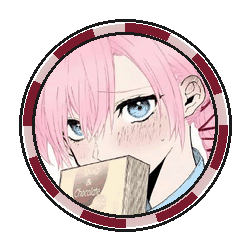
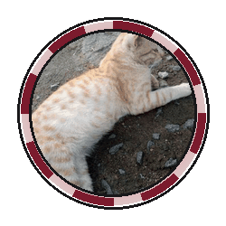
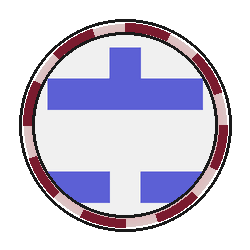
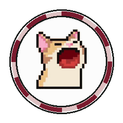

<div align="center">


[](https://usrc.my.id)
[](https://nextjs.org)
[](https://supabase.com)
[](https://typescriptlang.org)
[](https://vercel.com)

<a href="https://usrc.my.id">
  
</a>

</div>

---

## ✦ Tentang

**USRC Web** adalah rumah digital resmi **UBSI Study & Research Club** — komunitas lintas prodi (Informatika, Sistem Informasi, SI Akuntansi) di Universitas Bina Sarana Informatika Pontianak.

Satu kalimat: **tempat anggota absen & kelola kegiatan, sekaligus etalase karya nyata untuk publik.**

> Prinsip produk: serba interaktif. Kalau bisa dihitung dari database, jangan diketik manual. Stat landing, feed kegiatan, galeri karya — semuanya hidup dari Supabase.

---

## ⚡ Fitur

| | Fitur | Detail |
|---|---|---|
| 🏛 | **Landing Publik** | Hero, statistik live dari DB, feed kegiatan terakhir, etalase karya |
| 📝 | **Pendaftaran Online** | Form calon anggota → antrian approve sekre → magic link otomatis |
| 🔑 | **Login Tanpa Password** | Email OTP 6 digit via Supabase Auth — aman & anti-lupa-sandi |
| 🎫 | **Absen Realtime** | Window absen server-side, tiket digital dengan stamp HADIR/PENDING |
| 🗂 | **Dashboard Sekre** | Approve absen & pendaftar realtime (Supabase Realtime), daftar anggota |
| 🛡 | **Panel Admin** | Kelola role anggota, approve/reject karya, aktivitas admin tercatat |
| 🖼 | **Etalase Karya** | Showcase project anggota + sistem bintang ⭐, filter kategori |
| 🐾 | **Pixel Story** | Avatar hewan pixel custom + kartu status & catatan antar anggota |
| 👤 | **Profil Anggota** | Bio, sosmed, link fleksibel, avatar pixel personal |
| 🔗 | **Rich Link Preview** | Open Graph metadata — share `usrc.my.id` muncul kartu cantik |

---

## 🛠 Tech Stack

```txt
// FRONTEND
Next.js 16 (App Router) · TypeScript · Tailwind CSS v4 · Framer Motion

// BACKEND
Supabase — PostgreSQL · Row Level Security · Realtime · Email OTP

// INFRA
Vercel (auto-deploy dari main) · Domain usrc.my.id
```

**Gaya visual:** Editorial Neobrutalist — kertas hangat, border tegas, hard shadow maroon, font display uppercase + IBM Plex Mono untuk komentar `// zine`.

---

## 🗺 Peta Halaman

| Route | Akses | Isi |
|---|---|---|
| `/` | Publik | Landing, statistik, kegiatan, karya |
| `/daftar` | Publik | Form pendaftaran anggota |
| `/login` | Publik | Login email OTP |
| `/karya` | Publik | Etalase karya + pixel story |
| `/dashboard` | Anggota | Feed kegiatan & karya |
| `/dashboard/absen` | Anggota | Absen sesi aktif + riwayat |
| `/profil` | Anggota | Edit profil, avatar pixel, sosmed |
| `/dashboard/sekre` | Sekre | Approve absen, pendaftar, anggota |
| `/dashboard/admin` | Admin | Role management, approve karya |

---

## ⚔️ Kontributor

<div align="center">


<table>
  <tr>
    <td align="center" width="20%">
      <a href="https://github.com/kabayy-sys">
        <br />
        <sub><b>RAKEN</b></sub>
      </a><br />
      <sub><b>Backend Lead</b><br />Database · RLS · Auth<br />Audit PR · DevOps · 190+ commits</sub>
    </td>
    <td align="center" width="20%">
      <a href="https://github.com/Greeezzz">
        <br />
        <sub><b>CHELLO</b></sub>
      </a><br />
      <sub><b>Frontend Publik</b><br />Landing · Etalase Karya<br />Pixel Story UI · 30 commits</sub>
    </td>
    <td align="center" width="20%">
      <a href="https://github.com/Im-Wann">
        <br />
        <sub><b>IWAN</b></sub>
      </a><br />
      <sub><b>Frontend Dashboard</b><br />Absen Realtime · Panel Sekre<br />Panel Admin · Navbar · 12 commits</sub>
    </td>
    <td align="center" width="20%">
      <a href="https://github.com/riskiriski-eng">
        <br />
        <sub><b>RISKI</b></sub>
      </a><br />
      <sub><b>Auth & Admin</b><br />Halaman Login OTP<br />Panel Admin · Pixel Clothing</sub>
    </td>
    <td align="center" width="20%">
      <a href="https://github.com/Adityaprayoga15">
        <br />
        <sub><b>ADIT</b></sub>
      </a><br />
      <sub><b>Pixel Artist</b><br />6 Aset Avatar Hewan<br />Layer Aksesori · SVG</sub>
    </td>
  </tr>
</table>

</div>

---

## 📈 Aktivitas Pengembangan


---

## 🚀 Jalankan Lokal

```bash
# clone
git clone https://github.com/UBSI-Study-Research-Club/USRC-MAIN-PROJECT.git
cd USRC-MAIN-PROJECT

# install
npm install

# siapkan .env.local
NEXT_PUBLIC_SUPABASE_URL=<url-project-supabase>
NEXT_PUBLIC_SUPABASE_ANON_KEY=<anon-key>

# jalan
npm run dev
```

---

<div align="center">


</div>
